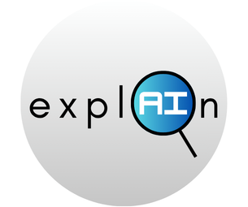

<!-- Improved compatibility of back to top link: See: https://github.com/othneildrew/Best-README-Template/pull/73 -->
<a id="readme-top"></a>
<!--
*** Thanks for checking out the Best-README-Template. If you have a suggestion
*** that would make this better, please fork the repo and create a pull request
*** or simply open an issue with the tag "enhancement".
*** Don't forget to give the project a star!
*** Thanks again! Now go create something AMAZING! :D
-->


<!-- PROJECT SHIELDS -->
<!--
*** I'm using markdown "reference style" links for readability.
*** Reference links are enclosed in brackets [ ] instead of parentheses ( ).
*** See the bottom of this document for the declaration of the reference variables
*** for contributors-url, forks-url, etc. This is an optional, concise syntax you may use.
*** https://www.markdownguide.org/basic-syntax/#reference-style-links
-->
[![Contributors][contributors-shield]][contributors-url]
[![Forks][forks-shield]][forks-url]
[![Stargazers][stars-shield]][stars-url]
[![Issues][issues-shield]][issues-url]
[![project_license][license-shield]][license-url]


<!-- PROJECT LOGO -->
<br />
<div align="center">
  <a href="https://github.com/github_username/repo_name">
    
  </a>

<h3 align="center">Welcome to TrustLens :3</h3>

  <p align="center">
    TrustLens is a web-based framework for benchmarking Explainable Artificial Intelligence (XAI) in medical imaging. The project aims to evaluate and compare how deep learning models make predictions and how reliably different XAI methods explain those predictions.

Our initial focus is on glaucoma detection using retinal images, where we plan to compare convolutional neural networks (CNNs), such as ResNet50 and DenseNet121, and generate visual explanations using techniques like Grad-CAM, Integrated Gradients, and LIME.

TrustLens will also evaluate explanation quality using metrics such as faithfulness, robustness, and localization, with the goal of supporting more transparent, interpretable, and trustworthy AI research in healthcare.
    <br />
    <a href="https://github.com/github_username/repo_name"><strong>Explore the Demo »</strong></a>
    <br />
    <br />
    <a href="https://github.com/github_username/repo_name">View Demo</a>
    
  </p>
</div>


<!-- TABLE OF CONTENTS -->
<details>
  <summary>Table of Contents</summary>
  <ol>
    <li>
      <a href="#about-the-project">About The Project</a>
      <ul>
        <li><a href="#built-with">Built With</a></li>
      </ul>
    </li>
    <li>
      <a href="#getting-started">Getting Started</a>
      <ul>
        <li><a href="#prerequisites">Prerequisites</a></li>
        <li><a href="#installation">Installation</a></li>
      </ul>
    </li>
    <li><a href="#usage">Usage</a></li>
    <li><a href="#roadmap">Roadmap</a></li>
    <li><a href="#contributing">Contributing</a></li>
    <li><a href="#license">License</a></li>
    <li><a href="#contact">Contact</a></li>
    <li><a href="#acknowledgments">Acknowledgments</a></li>
  </ol>
</details>


<!-- ABOUT THE PROJECT -->
## About The Project

[![Product Name Screen Shot][product-screenshot]](https://example.com)

Here's a blank template to get started. To avoid retyping too much info, do a search and replace with your text editor for the following: `github_username`, `repo_name`, `twitter_handle`, `linkedin_username`, `email_client`, `email`, `project_title`, `project_description`, `project_license`

<p align="right">(<a href="#readme-top">back to top</a>)</p>


### Built With

* [![Python][Python.org]][Python-url]
* [![PyTorch][PyTorch.org]][PyTorch-url]
* [![Captum][Captum.org]][Captum-url]
* [![Quantus][Quantus.org]][Quantus-url]
* [![ResNet50][ResNet50.org]][ResNet50-url]
* [![Node.js][Node.js.org]][Node-url]
* [![JavaScript][JavaScript.org]][JavaScript-url]
* [![React][React.js]][React-url]


<p align="right">(<a href="#readme-top">back to top</a>)</p>


<!-- GETTING STARTED -->
## Getting Started

### Design Review demo

From the repository root:

```bash
cd src/frontend
npm ci
npm run dev
```

Open http://127.0.0.1:5173/app and choose an image your browser can display.
The preview stays in the browser tab and the fixed results appear after a
two-second simulation. The demo runs independently of Flask.

The three explanation panels are bundled in `src/frontend/public/assets/`.
They are full-resolution crops from columns two through four of
`V0075_resnet50_320_weight9_coloraug_disccrop70_lr01_seed42_captum.png`.
The dashboard shows a placeholder if an individual asset fails to load.

Set `VITE_TRUSTLENS_DEMO_MODE=false` before starting Vite or building to open
the existing Flask-backed prototype at `/app`. For future live inference,
integrate the trained model and evaluation into `/api/analyze`, preserving
the response fields used by the existing dashboard. The flag selects the
workspace. Flask currently returns mock data or reports live analysis unavailable.

### Running Locally for the first time

### Prerequisites
- Python 3.10+
- Node.js and npm
- Git

### 1. Backend (Flask)
From the repository root:

```bash
cd src/backend
python3 -m venv .venv
source .venv/bin/activate
pip install -r requirements.txt
python app.py
```

Backend: http://localhost:5000

Test API: http://localhost:5000/api/health

### 2. Frontend (React + Vite)
Open a second terminal from the repository root:

```bash
cd src/frontend
npm install
npm run dev
```

Frontend: http://localhost:5173

Keep both terminals running when using the Flask-backed workspace.

### 3. Automated Tests

Backend:
```bash
cd src/backend
source .venv/bin/activate
python -m pytest -q tests
```

Frontend:
```bash
cd src/frontend
npm test
```

### 4. Dependencies

**Backend — requirements.txt**

Lists Python packages required by Flask and the AI pipeline.

Install dependencies:
```bash
pip install -r requirements.txt
```

When adding a new Python library:
1. Install it in the virtual environment.
2. Add it to `requirements.txt` with a tested version.
3. Commit the updated file.

Example:
```bash
pip install flask-cors
pip show flask-cors
```

Add the installed version to `requirements.txt`:
```text
flask-cors==<installed-version>
```

**Frontend — package.json**

Lists React/Vite dependencies.

Install dependencies:
```bash
npm install
```

Add a new package:
```bash
npm install package-name
```

Commit both `package.json` and `package-lock.json`.

## Running locally not for the first time


After the initial setup, open two terminals from the repository root.

**Terminal 1 — Backend (Flask)**
```bash
cd src/backend
source .venv/bin/activate
python app.py
```

**Terminal 2 — Frontend (React + Vite)**
```bash
cd src/frontend
npm run dev
```

**Access the application:**
- Frontend: http://localhost:5173
- Backend: http://localhost:5000
- API health check: http://localhost:5000/api/health

Keep both terminals running while developing.
Press `Ctrl + C` in each terminal to stop the servers.

**Note:** No need to reinstall dependencies unless
`requirements.txt` or `package.json` changes.


### Notes
- Initial setup commands only need to run once.
- Start Flask and Vite each development session.
- Never commit `.venv/`, `node_modules/`, or datasets.
- The current AI results are simulated until real models are integrated.


<p align="right">(<a href="#readme-top">back to top</a>)</p>

##

<!-- USAGE EXAMPLES -->
## Usage

Use this space to show useful examples of how a project can be used. Additional screenshots, code examples and demos work well in this space. You may also link to more resources.

## ResNet50 & Captum XAI Pipeline

The `src/models/` directory contains a modular PyTorch pipeline for fine-tuning a pre-trained **ResNet50** classifier on the **REFUGE** retinal fundus dataset and generating side-by-side **Captum** explainability heatmaps (**Integrated Gradients**, **Grad-CAM**, and **LIME**).

### Directory Structure

```text
src/
├── Makefile                     # Automation commands for setup, training, and XAI
├── requirements.txt             # PyTorch, Captum, scikit-image, and utility dependencies
└── models/
    ├── configs/
    │   └── config.yaml          # Hyperparameters, class weights (1:9), and XAI settings
    ├── data/                    # Local dataset directory (ignored by Git)
    │   └── REFUGE/
    │       ├── train/           # 400 images (Glaucoma / Non-Glaucoma)
    │       ├── val/             # 400 images (Glaucoma / Non-Glaucoma)
    │       └── test/            # 400 images (Glaucoma / Non-Glaucoma)
    ├── outputs/                 # Saved checkpoints and heatmap PNGs (ignored by Git)
    │   ├── checkpoints/         # Best fine-tuned weights (resnet50_best.pth)
    │   └── heatmaps/            # Side-by-side Captum comparison figures
    ├── scripts/
    │   ├── prepare_refuge.py    # Sorts raw REFUGE splits into class folders
    │   ├── run_train.py         # CLI entry point for model fine-tuning
    │   └── run_explain.py       # CLI entry point for Captum attribution generation
    ├── dataset.py               # REFUGEDataset class and ImageNet transforms
    ├── model.py                 # Pre-trained ResNet50 architecture and binary head
    ├── train.py                 # Training/validation loop with weighted CrossEntropyLoss
    └── explain.py               # Integrated Gradients, Grad-CAM, and LIME wrappers
```

### 1. Environment Setup

All commands below should be run from the `src/` directory. The `Makefile` automatically creates and manages an isolated `.venv/` virtual environment:

```bash
cd src
make setup   # Creates .venv and installs requirements.txt
make check   # Verifies module imports and CUDA GPU availability
```

### 2. Preparing the REFUGE Dataset

Raw datasets and `.pth` checkpoints are excluded from version control. After downloading the **REFUGE** dataset locally, extract it to a temporary staging folder (e.g., `src/models/data/raw_refuge/REFUGE/`) and sort each split into `Glaucoma/` and `Non-Glaucoma/` subdirectories:

```bash
# Sort Training Split (400 images via g*/n* filename prefixes)
PYTHONPATH=. .venv/bin/python -m models.scripts.prepare_refuge \
  --raw_dir models/data/raw_refuge/REFUGE/REFUGE-Training400 \
  --out_dir models/data/REFUGE/train

# Sort Validation Split (400 images via ground-truth spreadsheet)
PYTHONPATH=. .venv/bin/python -m models.scripts.prepare_refuge \
  --raw_dir models/data/raw_refuge/REFUGE/REFUGE-Validation400 \
  --labels models/data/raw_refuge/REFUGE/REFUGE-Validation400-GT/REFUGE-Validation400-GT/Fovea_locations.xlsx \
  --out_dir models/data/REFUGE/val

# Sort Test Split (400 images via ground-truth spreadsheet)
PYTHONPATH=. .venv/bin/python -m models.scripts.prepare_refuge \
  --raw_dir models/data/raw_refuge/REFUGE/Test400 \
  --labels models/data/raw_refuge/REFUGE/REFUGE-Test-GT/Glaucoma_label_and_Fovea_location.xlsx \
  --out_dir models/data/REFUGE/test
```

Once verified (1,200 images total), remove the temporary `src/models/data/raw_refuge/` directory.

### 3. Training & Generating XAI Explanations

* **Train ResNet50:** Fine-tunes the pre-trained ResNet50 using `[1.0, 9.0]` class weighting to address REFUGE's 1:9 glaucoma imbalance and saves the lowest validation-loss checkpoint to `src/models/outputs/checkpoints/resnet50_best.pth`:
  ```bash
  make train
  ```

* **Generate Captum Explanations:** Loads the saved checkpoint without retraining and outputs a 4-panel comparison (**Original**, **Integrated Gradients**, **Grad-CAM**, and **LIME**) to `src/models/outputs/heatmaps/`:
  ```bash
  # Explain a specific test image
  make explain IMAGE=models/data/REFUGE/test/Glaucoma/T0001.jpg

  # Or run without IMAGE= to explain a random test image
  make explain
  ```

### 4. Configuration Reference (`src/models/configs/config.yaml`)

All dataset paths, training parameters, and Captum attribution settings are centralized in `config.yaml`:

| Section | Parameter | Default | Description |
| :--- | :--- | :--- | :--- |
| **`data`** | `image_size` | `224` | Input resolution (`224 × 224`) required by ResNet50. |
| **`data`** | `batch_size` | `16` | Number of images per training/validation batch. |
| **`training`** | `epochs` | `10` | Total fine-tuning passes over the training dataset. |
| **`training`** | `learning_rate` | `0.0001` | AdamW optimizer step size (`1e-4`). |
| **`training`** | `class_weights` | `[1.0, 9.0]` | Loss weights for `[Non-Glaucoma, Glaucoma]` to offset the 1:9 class imbalance. |
| **`explainability`** | `ig_steps` | `50` | Number of interpolation steps used by Integrated Gradients. |
| **`explainability`** | `lime_segments` | `100` | Target number of SLIC superpixels generated per fundus image for LIME. |
| **`explainability`** | `lime_samples` | `500` | Number of perturbed image samples evaluated by LIME's surrogate model. |
| **`explainability`** | `lime_batch_size` | `32` | Perturbations evaluated per GPU forward pass during LIME attribution. |


_For more examples, please refer to the [Documentation](https://example.com)_

<p align="right">(<a href="#readme-top">back to top</a>)</p>


<!-- ROADMAP -->
## Roadmap

- [ ] Feature 1
- [ ] Feature 2
- [ ] Feature 3
    - [ ] Nested Feature

See the [open issues](https://github.com/github_username/repo_name/issues) for a full list of proposed features (and known issues).

<p align="right">(<a href="#readme-top">back to top</a>)</p>


<!-- CONTRIBUTING -->
## Contributing

Contributions are what make the open source community such an amazing place to learn, inspire, and create. Any contributions you make are **greatly appreciated**.

If you have a suggestion that would make this better, please fork the repo and create a pull request. You can also simply open an issue with the tag "enhancement".
Don't forget to give the project a star! Thanks again!

1. Fork the Project
2. Create your Feature Branch (`git checkout -b feature/AmazingFeature`)
3. Commit your Changes (`git commit -m 'Add some AmazingFeature'`)
4. Push to the Branch (`git push origin feature/AmazingFeature`)
5. Open a Pull Request

<p align="right">(<a href="#readme-top">back to top</a>)</p>


<!-- LICENSE -->
## License

Distributed under the project_license. See `LICENSE.txt` for more information.

<p align="right">(<a href="#readme-top">back to top</a>)</p>


<!-- CONTACT -->
## Contact

Daira Santacruz - djs738@nau.edu
Rita Bolanos - reb442@nau.edu
Nathan Class - nc426@nau.edu

Project Link: [https://github.com/github_username/repo_name](https://github.com/github_username/repo_name)

<p align="right">(<a href="#readme-top">back to top</a>)</p>


<!-- ACKNOWLEDGMENTS -->
## Acknowledgments

* []()
* []()
* []()

<p align="right">(<a href="#readme-top">back to top</a>)</p>


<!-- MARKDOWN LINKS & IMAGES -->
<!-- https://www.markdownguide.org/basic-syntax/#reference-style-links -->

<!-- Contributors -->
[contributors-shield]: https://img.shields.io/github/contributors/ClassProg/TrustLens.svg?style=for-the-badge
[contributors-url]: https://github.com/ClassProg/TrustLens/graphs/contributors


<!-- FORKS -->
[forks-shield]: https://img.shields.io/github/forks/ClassProg/TrustLens.svg?style=for-the-badge
[forks-url]: https://github.com/ClassProg/TrustLens/network/members

<!-- STARS -->
[stars-shield]: https://img.shields.io/github/stars/ClassProg/TrustLens.svg?style=for-the-badge
[stars-url]: https://github.com/ClassProg/TrustLens/stargazers

<!-- ISSUES -->
[issues-shield]: https://img.shields.io/github/issues/ClassProg/TrustLens.svg?style=for-the-badge
[issues-url]: https://github.com/ClassProg/TrustLens/issues

<!-- LICENSE -->
[license-shield]: https://img.shields.io/github/license/ClassProg/TrustLens.svg?style=for-the-badge
[license-url]: https://github.com/ClassProg/TrustLens/blob/main/LICENSE
[linkedin-shield]: https://img.shields.io/badge/-LinkedIn-black.svg?style=for-the-badge&logo=linkedin&colorB=555
[linkedin-url]: https://linkedin.com/in/linkedin_username
[product-screenshot]: images/screenshot.png
<!-- Shields.io badges. You can a comprehensive list with many more badges at: https://github.com/inttter/md-badges -->

<!-- TECHNOLOGIES -->
[Python.org]: https://img.shields.io/badge/Python-3776AB?style=for-the-badge&logo=python&logoColor=white
[Python-url]: https://www.python.org/

[PyTorch.org]: https://img.shields.io/badge/PyTorch-EE4C2C?style=for-the-badge&logo=pytorch&logoColor=white
[PyTorch-url]: https://pytorch.org/

[Captum.org]: https://img.shields.io/badge/Captum-7952B3?style=for-the-badge
[Captum-url]: https://captum.ai/

[Quantus.org]: https://img.shields.io/badge/Quantus-008080?style=for-the-badge
[Quantus-url]: https://github.com/understandable-machine-intelligence-lab/Quantus

[ResNet50.org]: https://img.shields.io/badge/ResNet50-FF6F00?style=for-the-badge
[ResNet50-url]: https://pytorch.org/vision/stable/models/generated/torchvision.models.resnet50.html

[Node.js.org]: https://img.shields.io/badge/Node.js-5FA04E?style=for-the-badge&logo=nodedotjs&logoColor=white
[Node-url]: https://nodejs.org/

[JavaScript.org]: https://img.shields.io/badge/JavaScript-F7DF1E?style=for-the-badge&logo=javascript&logoColor=black
[JavaScript-url]: https://developer.mozilla.org/en-US/docs/Web/JavaScript

[React.js]: https://img.shields.io/badge/React-61DAFB?style=for-the-badge&logo=react&logoColor=black
[React-url]: https://react.dev/
