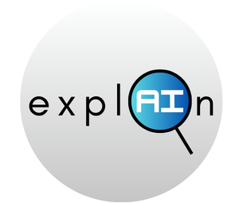

To be updated soon...

<!-- Improved compatibility of back to top link: See: https://github.com/othneildrew/Best-README-Template/pull/73 -->
<a id="readme-top"></a>
<!--
*** Thanks for checking out the Best-README-Template. If you have a suggestion
*** that would make this better, please fork the repo and create a pull request
*** or simply open an issue with the tag "enhancement".
*** Don't forget to give the project a star!
*** Thanks again! Now go create something AMAZING! :D
-->


<!-- PROJECT SHIELDS -->
<!--
*** I'm using markdown "reference style" links for readability.
*** Reference links are enclosed in brackets [ ] instead of parentheses ( ).
*** See the bottom of this document for the declaration of the reference variables
*** for contributors-url, forks-url, etc. This is an optional, concise syntax you may use.
*** https://www.markdownguide.org/basic-syntax/#reference-style-links
-->
[![Contributors][contributors-shield]][contributors-url]
[![Forks][forks-shield]][forks-url]
[![Stargazers][stars-shield]][stars-url]
[![Issues][issues-shield]][issues-url]
[![project_license][license-shield]][license-url]


<!-- PROJECT LOGO -->
<br />
<div align="center">
  <a href="https://github.com/github_username/repo_name">
    
  </a>

<h3 align="center">Welcome to TrustLens :3</h3>

  <p align="center">
    TrustLens is a web-based framework for benchmarking Explainable Artificial Intelligence (XAI) in medical imaging. The project aims to evaluate and compare how deep learning models make predictions and how reliably different XAI methods explain those predictions.

Our initial focus is on glaucoma detection using retinal images, where we plan to compare convolutional neural networks (CNNs), such as ResNet50 and DenseNet121, and generate visual explanations using techniques like Grad-CAM, Integrated Gradients, and LIME.

TrustLens will also evaluate explanation quality using metrics such as faithfulness, robustness, and localization, with the goal of supporting more transparent, interpretable, and trustworthy AI research in healthcare.
    <br />
    <a href="https://github.com/github_username/repo_name"><strong>Explore the Demo »</strong></a>
    <br />
    <br />
    <a href="https://github.com/github_username/repo_name">View Demo</a>
    
  </p>
</div>


<!-- TABLE OF CONTENTS -->
<details>
  <summary>Table of Contents</summary>
  <ol>
    <li>
      <a href="#about-the-project">About The Project</a>
      <ul>
        <li><a href="#built-with">Built With</a></li>
      </ul>
    </li>
    <li>
      <a href="#getting-started">Getting Started</a>
      <ul>
        <li><a href="#prerequisites">Prerequisites</a></li>
        <li><a href="#installation">Installation</a></li>
      </ul>
    </li>
    <li><a href="#usage">Usage</a></li>
    <li><a href="#roadmap">Roadmap</a></li>
    <li><a href="#contributing">Contributing</a></li>
    <li><a href="#license">License</a></li>
    <li><a href="#contact">Contact</a></li>
    <li><a href="#acknowledgments">Acknowledgments</a></li>
  </ol>
</details>


<!-- ABOUT THE PROJECT -->
## About The Project

[![Product Name Screen Shot][product-screenshot]](https://example.com)

Here's a blank template to get started. To avoid retyping too much info, do a search and replace with your text editor for the following: `github_username`, `repo_name`, `twitter_handle`, `linkedin_username`, `email_client`, `email`, `project_title`, `project_description`, `project_license`

<p align="right">(<a href="#readme-top">back to top</a>)</p>


### Built With

* [![Python][Python.org]][Python-url]
* [![PyTorch][PyTorch.org]][PyTorch-url]
* [![Captum][Captum.org]][Captum-url]
* [![Quantus][Quantus.org]][Quantus-url]
* [![ResNet50][ResNet50.org]][ResNet50-url]
* [![Node.js][Node.js.org]][Node-url]
* [![JavaScript][JavaScript.org]][JavaScript-url]
* [![React][React.js]][React-url]


<p align="right">(<a href="#readme-top">back to top</a>)</p>


<!-- GETTING STARTED -->
## Getting Started


### Prerequisites

This is an example of how to list things you need to use the software and how to install them.
* npm
  ```sh
  npm install npm@latest -g
  ```

### Installation

1. 
2. 
3. 
4. 
5. 

<p align="right">(<a href="#readme-top">back to top</a>)</p>


<!-- USAGE EXAMPLES -->
## Usage

Use this space to show useful examples of how a project can be used. Additional screenshots, code examples and demos work well in this space. You may also link to more resources.

_For more examples, please refer to the [Documentation](https://example.com)_

<p align="right">(<a href="#readme-top">back to top</a>)</p>


<!-- ROADMAP -->
## Roadmap

- [ ] Feature 1
- [ ] Feature 2
- [ ] Feature 3
    - [ ] Nested Feature

See the [open issues](https://github.com/github_username/repo_name/issues) for a full list of proposed features (and known issues).

<p align="right">(<a href="#readme-top">back to top</a>)</p>


<!-- CONTRIBUTING -->
## Contributing

Contributions are what make the open source community such an amazing place to learn, inspire, and create. Any contributions you make are **greatly appreciated**.

If you have a suggestion that would make this better, please fork the repo and create a pull request. You can also simply open an issue with the tag "enhancement".
Don't forget to give the project a star! Thanks again!

1. Fork the Project
2. Create your Feature Branch (`git checkout -b feature/AmazingFeature`)
3. Commit your Changes (`git commit -m 'Add some AmazingFeature'`)
4. Push to the Branch (`git push origin feature/AmazingFeature`)
5. Open a Pull Request

<p align="right">(<a href="#readme-top">back to top</a>)</p>


<!-- LICENSE -->
## License

Distributed under the project_license. See `LICENSE.txt` for more information.

<p align="right">(<a href="#readme-top">back to top</a>)</p>


<!-- CONTACT -->
## Contact

Your Name - [@twitter_handle](https://twitter.com/twitter_handle) - email@email_client.com

Project Link: [https://github.com/github_username/repo_name](https://github.com/github_username/repo_name)

<p align="right">(<a href="#readme-top">back to top</a>)</p>


<!-- ACKNOWLEDGMENTS -->
## Acknowledgments

* []()
* []()
* []()

<p align="right">(<a href="#readme-top">back to top</a>)</p>


<!-- MARKDOWN LINKS & IMAGES -->
<!-- https://www.markdownguide.org/basic-syntax/#reference-style-links -->

<!-- Contributors -->
[contributors-shield]: https://img.shields.io/github/contributors/ClassProg/TrustLens.svg?style=for-the-badge
[contributors-url]: https://github.com/ClassProg/TrustLens/graphs/contributors


<!-- FORKS -->
[forks-shield]: https://img.shields.io/github/forks/ClassProg/TrustLens.svg?style=for-the-badge
[forks-url]: https://github.com/ClassProg/TrustLens/network/members

<!-- STARS -->
[stars-shield]: https://img.shields.io/github/stars/ClassProg/TrustLens.svg?style=for-the-badge
[stars-url]: https://github.com/ClassProg/TrustLens/stargazers

<!-- ISSUES -->
[issues-shield]: https://img.shields.io/github/issues/ClassProg/TrustLens.svg?style=for-the-badge
[issues-url]: https://github.com/ClassProg/TrustLens/issues

<!-- LICENSE -->
[license-shield]: https://img.shields.io/github/license/ClassProg/TrustLens.svg?style=for-the-badge
[license-url]: https://github.com/ClassProg/TrustLens/blob/main/LICENSE
[linkedin-shield]: https://img.shields.io/badge/-LinkedIn-black.svg?style=for-the-badge&logo=linkedin&colorB=555
[linkedin-url]: https://linkedin.com/in/linkedin_username
[product-screenshot]: images/screenshot.png
<!-- Shields.io badges. You can a comprehensive list with many more badges at: https://github.com/inttter/md-badges -->

<!-- TECHNOLOGIES -->
[Python.org]: https://img.shields.io/badge/Python-3776AB?style=for-the-badge&logo=python&logoColor=white
[Python-url]: https://www.python.org/

[PyTorch.org]: https://img.shields.io/badge/PyTorch-EE4C2C?style=for-the-badge&logo=pytorch&logoColor=white
[PyTorch-url]: https://pytorch.org/

[Captum.org]: https://img.shields.io/badge/Captum-7952B3?style=for-the-badge
[Captum-url]: https://captum.ai/

[Quantus.org]: https://img.shields.io/badge/Quantus-008080?style=for-the-badge
[Quantus-url]: https://github.com/understandable-machine-intelligence-lab/Quantus

[ResNet50.org]: https://img.shields.io/badge/ResNet50-FF6F00?style=for-the-badge
[ResNet50-url]: https://pytorch.org/vision/stable/models/generated/torchvision.models.resnet50.html

[Node.js.org]: https://img.shields.io/badge/Node.js-5FA04E?style=for-the-badge&logo=nodedotjs&logoColor=white
[Node-url]: https://nodejs.org/

[JavaScript.org]: https://img.shields.io/badge/JavaScript-F7DF1E?style=for-the-badge&logo=javascript&logoColor=black
[JavaScript-url]: https://developer.mozilla.org/en-US/docs/Web/JavaScript

[React.js]: https://img.shields.io/badge/React-61DAFB?style=for-the-badge&logo=react&logoColor=black
[React-url]: https://react.dev/
